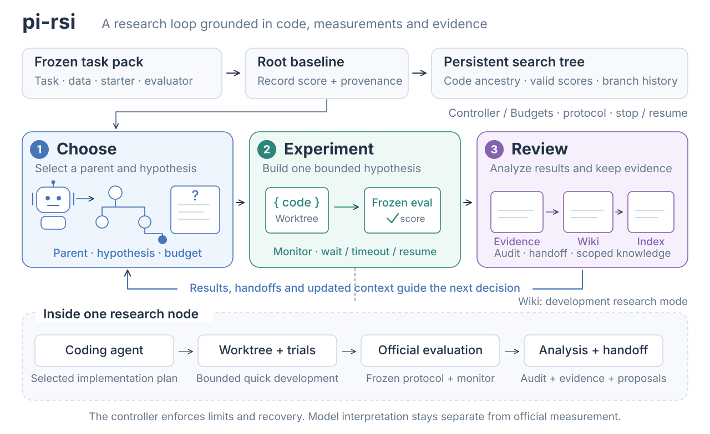
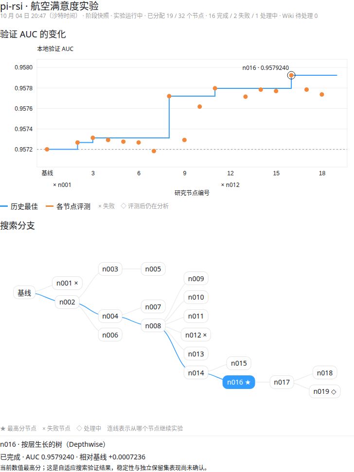

# pi-rsi — auto-research harness

[English](README.md) · [简体中文](README.zh-CN.md)

Status: v0.1, research prototype, developed and run on one Linux workstation (RTX 3090 + RTX 2080 Ti). Agents run
through a pinned [pi](https://github.com/earendil-works/pi) 0.85.1 (OpenAI Codex models in the recent runs) or the
Grok CLI. MIT licensed.

Write-ups and interactive records: **[xiehuanyi.github.io/pi-rsi](https://xiehuanyi.github.io/pi-rsi/)** —
[CASMI26: a biased proxy and its fix](https://xiehuanyi.github.io/pi-rsi/en/blog/pi-rsi-casmi26-proxy-alignment-20261015/) ·
[airline experiment and research Wiki](https://xiehuanyi.github.io/pi-rsi/en/blog/pi-rsi-airline-20261004/) ·
[earlier notebook (Chinese)](https://xiehuanyi.github.io/pi-rsi/rsi/).

## Overview

pi-rsi turns a task pack—problem, starter code and **frozen evaluator**—into a persistent research tree.
Agents choose and implement hypotheses in isolated Git worktrees; the harness records official measurements,
judges them, and retains the notes for the next decision. Budgets, waiting and recovery are controller responsibilities.

<picture>
  <source media="(prefers-color-scheme: dark)" srcset="docs/assets/pi-rsi-overview-en-dark.svg">
  
</picture>

## How a research run works

New experiments use a **sequential research loop over the search tree** (`--no-research-loop` keeps the legacy
tree scheduler; existing experiments opt in with `rsi research enable <experiment>`):

1. **Setup** (`rsi setup`, required before the first run). The baseline is evaluated repeatedly to measure
   run-to-run noise; a reviewer agent reads the task pack and raises risks and questions; the human answers. With
   `--yolo` a human-proxy agent answers routine questions, but every critical or human-only question of the first
   setup still goes to the human. The decisions (practical threshold, budget allocation, …) live in `setup/setup.json`.
2. **Decide.** After each official result, the research lead proposes the next experiment in prose (`NEXT.md`). A
   full review of the whole tree (with reference reading) runs on the first decision, every `research.review_every`
   experiments, on plateaus, on new human direction and before any stop, and writes `DECISION.md`. The lead never
   writes JSON: a small model (GPT-6 Luna) structures the text; the harness checks what decides execution (parent
   node, budget, a quote of the decision) and only warns about audit fields.
3. **Implement.** A worker implements and tunes that one approach in its own worktree within the budget, and
   writes `IMPLEMENTATION.md` and `DELIVERY.json` (what the delivered commit runs; switched-off components are
   measured switched on).
4. **Measure.** The official evaluation runs through a job queue with the frozen evaluator. The harness verdict
   (`eval/comparison.json`) counts a gain only above the larger of the measured noise band and the practical
   threshold; it is the single judgement every other file cites.
5. **Analyze.** The lead writes `HANDOFF.md` (what the result means) and `NEXT.md` (what to do next). GPT-6 Luna
   maintains the three-layer research Wiki (raw evidence, knowledge pages, index); `PROXY.md` tracks how
   development, forecast and official deltas agree, and `rsi observe` feeds results on the real target back in.
6. **Course correction.** After K experiments without real progress (default `search.patience`), a fresh reviewer
   agent questions data, model family, evaluation setup and search process (`course/kNNN/COURSE.md`); the next
   decision must be a full review that answers it.

Details: [research loop, setup and task monitor](docs/RESEARCH_LOOP.md) (Chinese).

## Case study: when the researcher picks a biased proxy (CASMI26, 2026-10)

A 4-day run on the Kaggle CASMI26 MS/MS-to-structure task stalled for 19 nodes at a local MRR of 0.404. An audit
found the research lead had turned the competition playbook's "never give back a won segment" into a development
gate: every class and source had to improve on both seeds, on a dev set where one segment had 14 molecules. Workers
therefore shipped new components switched off, and 22 of 31 official evaluations measured outputs identical to
their parent. The fix lives in the harness, not in per-run notes: the playbook now optimizes the official aggregate,
workers declare what they deliver (`DELIVERY.json`), switched-off components are measured switched on, a `PROXY.md`
ledger tracks how development, forecast and official deltas agree, and `rsi observe` feeds results on the real target
(e.g. the Kaggle leaderboard) back to the lead. Two nodes after the playbook change, the run found its first new best
in 20 nodes (0.4185, +0.0146); it ended at the 4-day limit with 0.4197 against a baseline of 0.307. Its setup review
had also found an ID-to-answer shortcut in the local benchmark, fixed before the run. Write-up with the interactive
score chart and search tree:
[English](https://xiehuanyi.github.io/pi-rsi/en/blog/pi-rsi-casmi26-proxy-alignment-20261015/) ·
[中文](https://xiehuanyi.github.io/pi-rsi/zh/blog/pi-rsi-casmi26-proxy-alignment-20261015/).

## Real experiment: airline satisfaction

A real RTX 2080 Ti search is archived with an offline chart, the full search explorer, aggregate metrics,
and exact baseline/current-best source. It is a preliminary snapshot of a continuing campaign.
The offline [research Wiki](examples/airline-s6e10-2080ti-20261004/wiki.html) links knowledge entries to
supporting/opposing evidence and published belief revisions.
Online: [experiment overview](https://xiehuanyi.github.io/pi-rsi/rsi/interactive/airline-20261004/en/),
[full search tree](https://xiehuanyi.github.io/pi-rsi/rsi/interactive/airline-20261004/en/tree/),
[research Wiki](https://xiehuanyi.github.io/pi-rsi/rsi/interactive/airline-20261004/en/wiki/).
Read the [English README](examples/airline-s6e10-2080ti-20261004/README.md) or
[中文 README](examples/airline-s6e10-2080ti-20261004/README.zh-CN.md).



## Layout

| path | what |
|---|---|
| `rsi`, `pi_rsi/cli.py` | CLI: `./rsi task|init|setup|run|status|continue|observe|render|eval|ops|write|...` |
| `pi_rsi/orchestrator.py` | the loop: root, setup gate, scheduling, supervision, stop, final report |
| `pi_rsi/research.py` | research decisions: proposals, full reviews, clarification, course correction, result analysis |
| `pi_rsi/decision.py` | structuring prose decisions and analyses (small model) and validating them |
| `pi_rsi/setup.py` | setup: noise calibration, reviewer, human / human-proxy decisions |
| `pi_rsi/proxy.py` | proxy-quality ledger (`PROXY.md`) and external observations (`rsi observe`) |
| `pi_rsi/evidence.py`, `measurement.py` | harness verdicts (noise band, practical threshold) and measurement integrity |
| `pi_rsi/scheduler.py` | parent eligibility, retries, budgets, stop conditions (and the legacy best-first scheduler) |
| `pi_rsi/worker.py` | one node end to end: worktree → session → commit → guard → eval → analysis → audit |
| `pi_rsi/memory.py`, `memory_prompts.py` | three-layer research Wiki |
| `pi_rsi/jobs.py`, `monitor.py`, `execution.py` | job queue daemon, task monitor, execution records and recovery |
| `pi_rsi/agents.py`, `ops.py` | utility agents (auditor, diagnoser, legacy planner), ops and narrative writer |
| `pi_rsi/runner/` | agent runtimes: `pi` (pinned pi, JSON mode), `grok` (official Grok CLI), `script` (tests) |
| `pi_rsi/prompts/*.md` | prompt templates |
| `pi_rsi/render.py` + `templates/` | self-contained tree explorer, `tree.md`, `REPORT.md` |
| `pi_rsi/tasks/`, `tasks/` | task packs (`task.toml`, `TASK.md`, `starter/`, `eval/`, `docs/`) |
| `examples/` | archived real experiments that open offline |
| `site/` | the public website (GitHub Pages) |
| `experiments/<name>/` | one directory per run (gitignored) |
| `tests/` | unit/integration suite and LLM-free end-to-end scripts |
| `scripts/` | watchdogs (`autoresume.sh`, `supervise.sh`), campaign launchers, comparison and publishing tools |
| `bin/pi`, `package.json` | pinned pi 0.85.1; wrapper disables update checks and telemetry |

## Install

```bash
uv tool install git+https://github.com/xiehuanyi/pi-rsi      # or: pipx install git+https://github.com/xiehuanyi/pi-rsi
rsi task list                                                 # bundled task packs
rsi task install kaggriculture                                # creates ~/.pi-rsi/tasks/kaggriculture with its own venv
```

Installed this way, experiments live under `~/.pi-rsi/experiments/` (override with `RSI_HOME`). Inside a git checkout,
`./rsi` uses the checkout's `tasks/` and `experiments/` instead, and the pinned pi from `package.json`
(`npm install --ignore-scripts`). Agent runtimes are external: `pi`
(`npm i -g @earendil-works/pi-coding-agent@0.85.1`, then `pi` + `/login` or an API key), or the `grok` CLI (logged in).

## Quick start

```bash
rsi init demo --task kaggriculture --runner pi --model openai-codex/gpt-6.1-sol --effort high \
    --utility-runner pi --utility-model openai-codex/gpt-6-luna --utility-effort medium --max-nodes 10
rsi setup demo             # noise calibration, setup review, you answer the critical questions (--yolo: a proxy answers routine ones)
rsi run demo               # resumable; Ctrl-C stops after in-flight nodes finish
rsi status demo
xdg-open ~/.pi-rsi/experiments/demo/tree.html   # re-rendered after every event
```

`rsi run` on an existing experiment resumes it: nodes that were running when the process died are marked failed,
diagnosed, and retried from their last commit; a saved but undispatched decision is re-validated instead of redone.
`scripts/autoresume.sh <exp dir> <launcher…>` keeps a campaign alive across crashes and recoverable faults.

More commands:

| command | what |
|---|---|
| `rsi setup <exp> [--answer id=value] [--accept-recommended] [--yolo]` | required before a research run: baseline repeats measure noise, a reviewer agent raises risks and questions, the human (or, for routine and mid-run questions, a human-proxy) decides; `setup/setup.json` owns thresholds and budgets |
| `rsi new-task <name> "<problem>" --data <dir\|kaggle:slug>` | clarification phase: data profile, questions with defaults, a builder agent writes the task pack, the harness verifies the evaluator on the starter |
| `rsi continue <exp> --max-nodes +N [--from n004] [--note "..."]` | extend a finished run: more budget, stall counter reset, optional focus node and a note every agent sees |
| `rsi observe <exp> "<what>" [--node n007] [--metric kaggle_public_lb] [--value 0.228]` | record a result on the real target (e.g. a leaderboard score); the research lead and course corrector see it next to `PROXY.md` |
| `rsi submit <exp> [--node n008]` | final-level evaluation (e.g. Kaggle submission) with a per-experiment cap and `SUBMISSIONS.md` ledger |
| `rsi research enable|status|repair <exp>` | switch an experiment to the research loop; re-validate a saved plan after a harness fix |
| `rsi ops <exp> "<problem>"` | logistics agent with tools: fixes environments, data prep, evaluator bugs; auto-called after two consecutive evaluator failures |
| `rsi write <exp>` / `rsi report <exp>` / `rsi relabel <exp>` / `rsi reeval <exp>` | narrative for humans; rebuild REPORT.md; recompute verdicts; re-run the official evaluator on every node |
| `rsi closeout <exp>` | finish analyses of measured nodes whose notes timed out; no new experiments |
| `rsi sentinel [--interval 600] [--kill-orphans] [--prune]` | infra check without an LLM: disk, GPUs, dead orchestrators, orphan processes, stale worktrees |
| `rsi repair <exp>` | harness self-repair: an ops agent fixes recorded harness crashes on a `repair/<ts>` git branch with a test; a human merges |
| `rsi jobd` / `rsi jobs` | job queue daemon and listing (job mode, below) |

## Search explorer

Open an experiment's `tree.html` for an offline, self-contained view: pan/zoom the search tree, follow the best
path, inspect each node's decision, implementation, result analysis and next step, and compare official progress
by completed nodes or wall clock. The searchable ledger and score curve select the same node as the tree. Baselines
participate in the best curve; failed/invalid scores never improve it. Final-level results remain separate.

`rsi render <experiment>` rebuilds the snapshot; refresh the browser to see updates. Dark/light themes and narrow
screens are supported. Embedded logs are **not automatically anonymized**—review before sharing.
See [visualization guide and tests](docs/VISUALIZATION.md).

## Job mode (long-running evaluations)

Task packs with `job_enabled = true` send every official evaluation through a queue (`rsi jobd`, started automatically)
that assigns GPUs (`CUDA_VISIBLE_DEVICES`), enforces `job_timeout_s`, kills stalled runs (no new curve point for
`job_stall_s`), kills NaN runs, and early-stops runs whose curve is worse than the incumbent's by `margin` for
`patience_points` checkpoints after `warmup_frac`. Jobs write `metrics.jsonl` (`{"step","value"}` per checkpoint) and
`metrics.json` (final score); `job_resumable = true` re-submits a failed job once with `--resume`. Each queue has
exactly one daemon (`jobd.lock`); jobs are claimed and launched atomically, and a restarted daemon adopts live jobs
under the same limits (PIDs are identity-checked before any signal). The attempt number lives in the task monitor, so
a restarted controller waits on the running attempt instead of resubmitting it. Levels replace seed sets
(`job_budgets = { smoke = ..., proxy = ..., full = ... }`): workers iterate on `smoke`, the official score is `proxy`,
and the top `final_top_k` nodes get a `full` run at the end. `search.max_gpu_hours` caps the run.
`tasks/toy-longjob` exercises all of this on CPU in a few minutes (`tests/test_jobs.sh`).

## What a run produces (`experiments/<name>/`)

Each kind of content has one home; other files cite it or are generated views of it.

| file | written by | content |
|---|---|---|
| `setup/setup.json` (`SETUP.md`, `REVIEW.md`) | human / human-proxy, reviewer | calibration, setup decisions, risks |
| `cycles/<c>/DECISION.md` (`decision.json`) | research lead (structured by Luna) | the decision that selected a node |
| `nodes/<id>/IMPLEMENTATION.md`, `PROGRESS.md`, `TUNING.jsonl`, `DELIVERY.json` | worker | what was built, development results, tuning, what the commit runs |
| `nodes/<id>/eval/metrics.<level>.json`, `eval/comparison.json` | harness | official score and the verdict |
| `nodes/<id>/HANDOFF.md` (`analysis.json`), `NEXT.md` | research lead | what the result means; what to do next |
| `nodes/<id>/audit.json` (`SUMMARY.md`) | auditor | summary and claim check against official numbers |
| `course/kNNN/COURSE.md` | fresh reviewer | course correction after a stall |
| `PROXY.md`, `observations.jsonl` | harness, human | proxy agreement and results on the real target |
| `tree.json`, `tree.html`, `REPORT.md`, `events.jsonl`, `costs.json` | harness | index, explorer, report, event log, spending |
| `INSIGHTS.md`, `DEADENDS.md` | harness | views of the research Wiki (supported / refuted claims) |

`HYPOTHESIS.md`, `FAILURE.md` and an optional `HUMAN.md` complete each node. In the legacy scheduler the worker
writes `HANDOFF.md` and `proposals.json`, and the auditor appends to `INSIGHTS.md` / `DEADENDS.md`.

## Research memory

Runs maintain a versioned research Wiki per task and evaluation protocol: immutable experimental evidence, scoped
observations/hypotheses/experience with supporting and opposing evidence, and an agenda of motivation, method and
open questions (plans stay in the research lead's decisions). Workers receive a saved memory snapshot. Use
`--memory-dir` (or `memory.path`) to isolate a study's Wiki from earlier ones, and `--no-memory` for a control run.
Existing runs opt in with `rsi memory enable <exp>`; import paper excerpts/notes with
`rsi memory ingest <exp> --source <file>`. See [configuration, evidence boundaries, and validation](docs/RESEARCH_MEMORY.md).

## Stopping, faults and recovery

- Stop: `max_nodes`, `max_attempts`, `max_wallclock_s`, `max_gpu_hours`, `target_score`, or a stop decision from a
  full review with explicit saturation checks. Why dispatch stopped and what still needs recovery are separate: an
  incomplete handoff, an unresolvable decision, unfinished nodes, a broken runner or an interrupt defer the final
  confirmation even when a budget stop came first (`final.json` lists them under `faults`; `rsi run` recovers).
- Decisions degrade gracefully: an unusable proposal falls back to a full review; a full review the small model
  cannot structure gets one clarifying question to the lead; only then does the run stop (`research_failed`).
- Official scores are bound to the evaluation protocol (evaluator files, scoring config, official level/budget,
  `memory.protocol_id`). If it changes, older scores stay on record as `stale` but stop being selection evidence;
  dispatch stops with `protocol_changed` until `rsi reeval` re-measures the baseline (or the evaluator is restored).
- Failed nodes (crash, timeout without usable work, evaluator failure, edits under `eval/`) are diagnosed; a retry with
  the diagnoser's advice continues the same hypothesis from its last commit (`max_retries`).
- Sessions killed at the budget get a **handoff rescue**: the same session is resumed once to write its notes only.
- Legacy scheduler: best-first parent choice with `width_root`/`width`/`depth` caps and a `patience` stop.

## Runners and models

- `pi`: pinned pi in `--mode json` with any provider pi supports (API keys or pi's own `/login` subscriptions). Add
  custom OpenAI/Anthropic-compatible providers via `~/.pi/agent/models.json`. Model string is `provider/model`,
  effort maps to pi's thinking level. Prompts go to pi on stdin (one argv string is capped at 128 KiB on Linux).
- `grok`: the official Grok CLI in headless mode (`--prompt-file`, `--output-format streaming-json`,
  `--json-schema` for utility calls, pre-assigned `--session-id` so a killed session can be resumed).
- `script`: an executable stand-in for tests.

Worker, research lead, utility and maintainer runners are configured independently (`[runner]`, `[research]`,
`[utility]`, `[maintainer]` in `rsi.toml`).

## Task packs

`tasks/<name>/task.toml` declares the brief, docs, starter directory, evaluator command and levels (`quick` for the
worker's iteration, `validation` for the official node score, `final` sealed for the end). The harness copies `eval/`
and `docs/` into each repo for the worker's convenience but always scores with its own frozen copy, and any commit
touching those paths fails the node. Task data and private labels stay out of Git.

## Website

The public site (write-ups, interactive score charts, search trees and Wikis) is static: everything under `site/`
is deployed to GitHub Pages by `.github/workflows/pages.yml` on every push to `main` that touches it.
`scripts/migrate_blog_to_pages.py` moved the earlier pages from the PocketPlay blog; new pages go into `site/` directly.

## Requirements

- Linux, Python 3.11+, Node 22 (for the pinned pi), git, `uv` or `pip`.
- An agent runtime: pi with a supported provider, or the `grok` CLI logged in with a subscription.

## Tests

```bash
python3 -m unittest discover -s tests -p 'test_*.py'   # unit/integration suite (research loop, setup, proxy,
                          # memory, scheduler, job daemon, recovery, unattended long-run failure modes)
tests/test_loop.sh        # whole legacy loop with a fake agent (~1 min)
tests/test_jobs.sh        # job mode: queue daemon, curves, analysis session, top-k final (~3 min, CPU)
tests/test_pi_runner.sh   # pi runner against a local mock OpenAI server (incl. a >300 KB prompt via stdin)
node tests/test_tree_model.cjs                          # explorer model; test_tree_browser.cjs needs playwright
```
