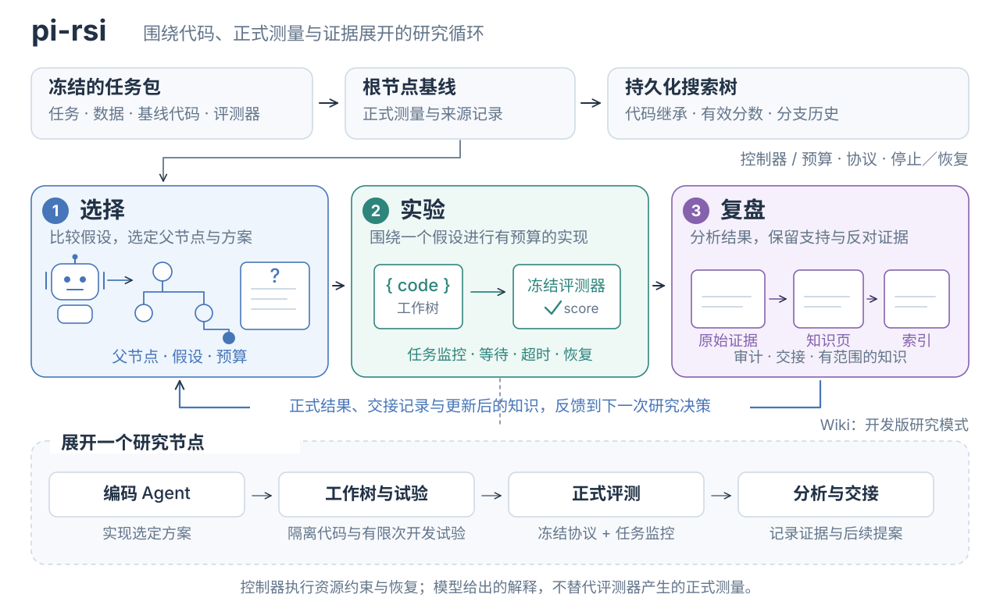

# pi-rsi：自动研究框架

[English](README.md) · [简体中文](README.zh-CN.md)

当前为 v0.1 研究原型，在一台 Linux 工作站（RTX 3090 + RTX 2080 Ti）上开发和运行。Agent 通过固定版本的
[pi](https://github.com/earendil-works/pi) 0.85.1（近期实验用 OpenAI Codex 模型）或 Grok CLI 运行。MIT 许可证。

文章与交互记录：**[xiehuanyi.github.io/pi-rsi](https://xiehuanyi.github.io/pi-rsi/zh/)** ——
[CASMI26：有偏的 proxy 与修正](https://xiehuanyi.github.io/pi-rsi/zh/blog/pi-rsi-casmi26-proxy-alignment-20261015/) ·
[航空实验与研究 Wiki](https://xiehuanyi.github.io/pi-rsi/zh/blog/pi-rsi-airline-20261004/) ·
[早期实验笔记](https://xiehuanyi.github.io/pi-rsi/rsi/)。

## 概览

pi-rsi 把任务包（问题说明、基线代码、**冻结的评估器**）变成一棵可持续推进的研究树。Agent 在各自独立的 Git
worktree 里选择并实现假设；框架记录官方测量、给出判定，并保留供下一次决策使用的记录。预算、等待和故障恢复都由
控制器负责，不让模型空等。

<picture>
  <source media="(prefers-color-scheme: dark)" srcset="docs/assets/pi-rsi-overview-zh-dark.svg">
  
</picture>

## 一次研究怎么运行

新实验默认使用**在搜索树上顺序执行的研究循环**（`--no-research-loop` 保留旧的树调度器；已有实验用
`rsi research enable <实验>` 切换）：

1. **Setup**（`rsi setup`，首次运行前必须完成）：基线重复评估，实测重跑噪声；评审 agent 阅读任务包，提出风险和
   问题；由人来回答。`--yolo` 时 human-proxy 可以代答次要问题，但首次 setup 中所有关键问题和只能由人决定的问题，
   仍然必须由人确认。实用门槛、预算分配等决定统一保存在 `setup/setup.json`。
2. **决策**：每个官方结果出来后，研究 lead 用自然语言写下一步（`NEXT.md`）。第一次决策、每隔
   `research.review_every` 个实验、出现平台期、人工指令变化、以及任何停止之前，会对整棵树做一次全局复盘（可查参考
   资料），写 `DECISION.md`。研究 lead 不写 JSON：小模型（GPT-6 Luna）把文字整理成结构化字段；框架严格检查决定
   执行的内容（父节点、预算、决定的原文引用），审计类字段只记警告。
3. **实现**：worker 在自己的 worktree 里实现这一个方案，并在预算内调参，写 `IMPLEMENTATION.md` 和
   `DELIVERY.json`（交付的提交实际运行什么；被关掉的新组件会按开启状态评测）。
4. **测量**：正式评估通过任务队列和冻结评估器运行。框架判定写在 `eval/comparison.json`：差值超过"实测噪声带"和
   "实用门槛"两者中较大的那个才算提升。这是唯一的判定，其他文件都引用它。
5. **分析**：研究 lead 写 `HANDOFF.md`（结果意味着什么）和 `NEXT.md`（下一步做什么）。GPT-6 Luna 维护三层研究
   Wiki（原始证据、知识页、索引）；`PROXY.md` 记录开发集、预测和官方结果是否一致，`rsi observe` 把真实目标上的
   结果反馈回来。
6. **中途纠错**：连续 K 个实验没有真实进展（默认等于 `search.patience`）时，一个全新的评审 agent 检查数据、模型族、
   评估设置和搜索方式（`course/kNNN/COURSE.md`）；下一次决策必须是回应纠错结论的全局复盘。

详见[研究循环、setup 与任务监控](docs/RESEARCH_LOOP.md)。

## 案例：研究者选了有偏的 proxy（CASMI26，2026-10）

在 Kaggle CASMI26（质谱到分子结构）任务上的一轮 4 天实验，本地 MRR 停在 0.404，连续 19 个节点没有进展。审查发现，研究 lead 把竞赛提示词里的"不能牺牲已经赢下的分段"变成了开发集上的交付门槛：每个类别、每个来源在两个 seed 上都不能下降，而其中一个分段只有 14 个分子。结果 worker 把新组件关掉再交付，31 次官方评测里有 22 次测的是和父节点完全相同的输出。修复放在框架和系统提示词里，而不是单次实验的人工备注：竞赛提示词改为优化官方总分；worker 用 `DELIVERY.json` 声明交付内容，被关掉的组件按开启状态评测；`PROXY.md` 记录开发集、预测和官方结果是否一致；`rsi observe` 把真实目标上的结果（如 Kaggle 排行榜）反馈给研究 lead。提示词修改后的第二个节点，就出现了 20 个节点以来的第一个新最佳（0.4185，+0.0146）；实验在 4 天墙钟上限时结束，最好 0.4197，基线 0.307。这次的 setup 评审还发现了本地基准里"凭分子 ID 能反推答案"的漏洞，开跑前已修复。

文章和交互图（分数轨迹、搜索树）：[中文](https://xiehuanyi.github.io/pi-rsi/zh/blog/pi-rsi-casmi26-proxy-alignment-20261015/) · [English](https://xiehuanyi.github.io/pi-rsi/en/blog/pi-rsi-casmi26-proxy-alignment-20261015/)。

## 真实实验：航空满意度

仓库包含一轮 RTX 2080 Ti 航空满意度研究的阶段归档：离线可视化、完整搜索树、各节点聚合指标、原始基线和当前最佳方案的源码。当前最佳验证 AUC 为 **0.9579240131**，基线为 **0.9572004066**；稳定提升尚未经过独立重复验证，最终保留集仍封存。

- [中文实验 README](examples/airline-s6e10-2080ti-20261004/README.zh-CN.md) · [English experiment README](examples/airline-s6e10-2080ti-20261004/README.md)
- 离线页面：[可视化](examples/airline-s6e10-2080ti-20261004/index.html)、[完整搜索树](examples/airline-s6e10-2080ti-20261004/tree.html)、[研究 Wiki](examples/airline-s6e10-2080ti-20261004/wiki.html)
- 在线页面：[实验概览](https://xiehuanyi.github.io/pi-rsi/rsi/interactive/airline-20261004/zh/)、[完整搜索树](https://xiehuanyi.github.io/pi-rsi/rsi/interactive/airline-20261004/zh/tree/)、[研究 Wiki](https://xiehuanyi.github.io/pi-rsi/rsi/interactive/airline-20261004/zh/wiki/)


下载仓库后直接用浏览器打开离线页面即可，无需 GPU 或登录。归档不是完整断点，不能直接继续原实验；复现边界写在实验 README 中。

## 主要目录

| 路径 | 用途 |
|---|---|
| `rsi`、`pi_rsi/cli.py` | 命令入口：`./rsi task|init|setup|run|status|continue|observe|render|eval|ops|write|...` |
| `pi_rsi/orchestrator.py` | 主循环：根节点、setup 门禁、调度、监控、停止、最终报告 |
| `pi_rsi/research.py` | 研究决策：提议、全局复盘、追问、中途纠错、结果分析 |
| `pi_rsi/decision.py` | 用小模型把自然语言决策和分析整理成结构化字段，并做校验 |
| `pi_rsi/setup.py` | setup：噪声校准、评审、人 / human-proxy 决定 |
| `pi_rsi/proxy.py` | proxy 质量台账（`PROXY.md`）和外部观测（`rsi observe`） |
| `pi_rsi/evidence.py`、`measurement.py` | 框架判定（噪声带、实用门槛）与测量完整性 |
| `pi_rsi/scheduler.py` | 父节点资格、重试、预算、停止条件（以及旧的最优优先调度器） |
| `pi_rsi/worker.py` | 单个节点的全过程：worktree → 会话 → 提交 → 保护检查 → 评测 → 分析 → 审计 |
| `pi_rsi/memory.py`、`memory_prompts.py` | 三层研究 Wiki |
| `pi_rsi/jobs.py`、`monitor.py`、`execution.py` | 任务队列守护进程、任务监控、执行记录与恢复 |
| `pi_rsi/agents.py`、`ops.py` | 辅助 agent（审计、诊断、旧规划器）、运维与叙述 |
| `pi_rsi/runner/` | Agent 运行器：`pi`、`grok`、`script`（测试） |
| `pi_rsi/prompts/*.md` | 提示词模板 |
| `pi_rsi/render.py`、`templates/` | 离线搜索树浏览器、`tree.md`、`REPORT.md` |
| `pi_rsi/tasks/`、`tasks/` | 任务包（`task.toml`、`TASK.md`、`starter/`、`eval/`、`docs/`） |
| `examples/` | 可离线查看的真实实验归档 |
| `site/` | 公开网站（GitHub Pages） |
| `experiments/<名称>/` | 每次运行一个目录（不进入 Git） |
| `tests/` | 单元 / 集成测试和不调用模型的端到端脚本 |
| `scripts/` | 看护进程（`autoresume.sh`、`supervise.sh`）、实验启动脚本、对比与发布工具 |

## 安装

环境要求：Linux、Python 3.11 或更新版本、Git，以及 `uv` 或 `pip`；pi 运行器还需要 Node 22。Agent 的运行环境和模型认证需单独准备。

```sh
uv tool install git+https://github.com/xiehuanyi/pi-rsi   # 或 pipx install git+https://github.com/xiehuanyi/pi-rsi
rsi task list
rsi task install kaggriculture
```

安装后的实验默认位于 `~/.pi-rsi/experiments/`，可通过 `RSI_HOME` 指定根目录。从 Git checkout 使用 `./rsi` 时，使用仓库内的任务包和 `experiments/`；执行 `npm install --ignore-scripts` 安装固定版本 pi。

## 开始一个实验

```sh
rsi init demo --task kaggriculture --runner pi --model openai-codex/gpt-6.1-sol --effort high \
  --utility-runner pi --utility-model openai-codex/gpt-6-luna --utility-effort medium --max-nodes 10
rsi setup demo    # 噪声校准、setup 评审，你回答关键问题（--yolo：次要问题由 proxy 代答）
rsi run demo      # 可恢复；Ctrl-C 会等进行中的节点结束后再停
rsi status demo
```

对已有实验执行 `rsi run` 会进入恢复流程：中断时正在运行的节点会被诊断，并从最后一次提交重试；已保存但还没派发的决策会重新校验后接着用，不会重做。`scripts/autoresume.sh <实验目录> <启动命令…>` 可以在进程崩溃或出现可恢复故障时自动续跑。

| 命令 | 用途 |
|---|---|
| `rsi setup <实验> [--answer id=值] [--accept-recommended] [--yolo]` | 研究模式运行前必须完成：校准噪声、评审提问、人或 proxy 做决定 |
| `rsi new-task <名称> "<问题>" --data <目录\|kaggle:slug>` | 澄清阶段：数据概况、带默认值的问题、builder agent 生成任务包、框架在基线上验证评估器 |
| `rsi continue <实验> --max-nodes +N [--from n004] [--note "..."]` | 给已结束的实验追加预算，可指定聚焦节点和给所有 agent 的备注 |
| `rsi observe <实验> "<内容>" [--node n007] [--metric kaggle_public_lb] [--value 0.228]` | 记录真实目标上的结果（如排行榜分数） |
| `rsi submit <实验> [--node n008]` | final 级评估（如 Kaggle 提交），有次数上限和 `SUBMISSIONS.md` 台账 |
| `rsi research enable\|status\|repair <实验>` | 切换到研究循环；框架修复后重新校验已保存的计划 |
| `rsi ops <实验> "<问题>"` | 带工具的运维 agent：修环境、数据准备、评估器问题 |
| `rsi write` / `rsi report` / `rsi relabel` / `rsi reeval` | 叙述、重建报告、重算判定、在所有节点上重跑官方评估 |
| `rsi closeout <实验>` | 补完因超时没写完的结果分析，不新增实验 |
| `rsi sentinel`、`rsi repair`、`rsi jobd` / `rsi jobs` | 基础设施检查、框架自修复、任务队列 |

准确参数以 `rsi <命令> --help` 为准。

## 每次运行留下什么（`experiments/<名称>/`）

每类内容只有一个归属文件，其他地方只引用它，或是从它生成的视图。

| 文件 | 作者 | 内容 |
|---|---|---|
| `setup/setup.json`（`SETUP.md`、`REVIEW.md`） | 人 / human-proxy、评审 agent | 噪声校准、setup 决定、风险 |
| `cycles/<c>/DECISION.md`（`decision.json`） | 研究 lead（Luna 整理） | 选中某个节点的决策 |
| `nodes/<id>/IMPLEMENTATION.md`、`PROGRESS.md`、`TUNING.jsonl`、`DELIVERY.json` | worker | 做了什么、开发集结果、调参、提交实际运行什么 |
| `nodes/<id>/eval/metrics.<级别>.json`、`eval/comparison.json` | 框架 | 官方分数和判定 |
| `nodes/<id>/HANDOFF.md`（`analysis.json`）、`NEXT.md` | 研究 lead | 结果意味着什么；下一步做什么 |
| `nodes/<id>/audit.json`（`SUMMARY.md`） | 审计 | 摘要和与官方数字的核对 |
| `course/kNNN/COURSE.md` | 纠错评审 | 停滞后的纠错结论 |
| `PROXY.md`、`observations.jsonl` | 框架、人 | proxy 一致性和真实目标上的结果 |
| `tree.json`、`tree.html`、`REPORT.md`、`events.jsonl`、`costs.json` | 框架 | 索引、浏览器、报告、事件日志、花费 |
| `INSIGHTS.md`、`DEADENDS.md` | 框架 | 研究 Wiki 的视图（已证实 / 已推翻的结论） |

每个节点还有 `HYPOTHESIS.md`、`FAILURE.md` 和可选的 `HUMAN.md`。旧调度器下由 worker 写 `HANDOFF.md` 和 `proposals.json`，审计员追加 `INSIGHTS.md` / `DEADENDS.md`。

## 研究 Wiki

每个任务和评估协议维护一个带版本的研究 Wiki：不可变的实验证据，区分观察、假设、经验并附支持与反对证据的知识页，以及动机、方法和未解决问题的研究议程（计划只放在研究 lead 的决策里）。worker 收到的是保存好的 Wiki 快照。用 `--memory-dir`（或 `memory.path`）可以让一次研究不继承以前的知识，`--no-memory` 用于对照实验。详见 [研究记忆](docs/RESEARCH_MEMORY.md)。

## 停止、故障与恢复

- 停止条件：`max_nodes`、`max_attempts`、`max_wallclock_s`、`max_gpu_hours`、`target_score`，或全局复盘给出附饱和检查的停止决定。"为什么停止派发"和"还有什么待恢复"分开判断：未完成的交接、无法结构化的决策、未结束的节点、运行器故障或中断，都会推迟最终确认（`final.json` 的 `faults`），`rsi run` 恢复后再确认。
- 决策逐级兜底：提议无法执行就转入全局复盘；复盘结果整理不出来就追问研究 lead 一次；都失败才停在 `research_failed`。
- 官方分数绑定评估协议（评估器文件、评分配置、正式级别与预算、`memory.protocol_id`）。协议变化后旧分数标为 `stale`，不再参与选择；派发停在 `protocol_changed`，直到 `rsi reeval` 重测基线或恢复原评估器。
- 失败节点会被诊断，并按诊断建议从最后一次提交继续同一个假设（`max_retries`）；预算耗尽的会话会被唤醒一次，只补写记录。

## 运行器

- `pi`：固定版本 pi 的 JSON 模式，支持 pi 能接的任何模型提供方，模型写作 `provider/model`；提示词经 stdin 传入。
- `grok`：官方 Grok CLI 的无界面模式。
- `script`：测试用替代运行器，不调用真实模型。

worker、研究 lead、辅助模型和 Wiki 维护者分别在 `rsi.toml` 的 `[runner]`、`[research]`、`[utility]`、`[maintainer]` 中配置。

## 网站

公开网站（文章、交互分数图、搜索树和 Wiki）是纯静态的：`site/` 下的内容在推送到 `main` 时由 `.github/workflows/pages.yml` 发布到 GitHub Pages。`scripts/migrate_blog_to_pages.py` 把早先放在 PocketPlay 博客上的页面迁了过来；新页面直接放进 `site/`。

## 验证

```sh
python3 -m unittest discover -s tests -p 'test_*.py'   # 单元与集成测试（研究循环、setup、proxy、Wiki、调度、任务队列、恢复、长时间无人值守的故障）
tests/test_loop.sh                                      # 用模拟 agent 跑完整的旧调度循环
tests/test_jobs.sh                                      # 任务队列模式（CPU，约 3 分钟）
tests/test_pi_runner.sh                                 # 用本地模拟服务测试 pi 运行器
node tests/test_tree_model.cjs                          # 搜索树浏览器模型；test_tree_browser.cjs 需要 playwright
```
